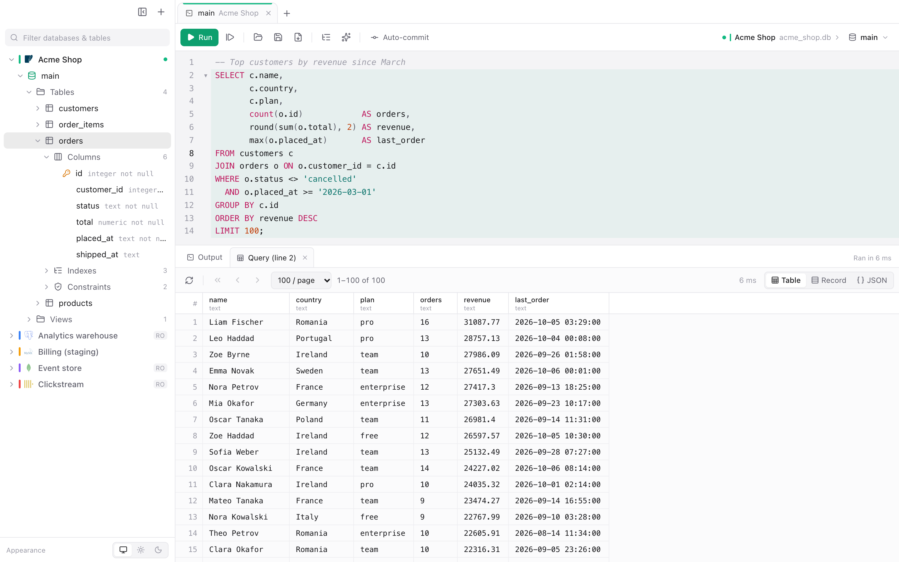

# Quire

Desktop database editor for PostgreSQL, MySQL/MariaDB, SQL Server, Oracle, SQLite, Azure
Cosmos DB, CockroachDB, YugabyteDB, Amazon Redshift, TiDB, ClickHouse and DuckDB (SQL), and
MongoDB and Amazon DocumentDB (mongo shell JavaScript), built with Go + Wails v3 + React.
A flaky network never makes you stop, reconnect and run a query again: connections heal
on their own, reads are retried, and paging a result never re-runs the script.

<picture>
  <source media="(prefers-color-scheme: dark)" srcset="docs/screenshot-dark.png">
  
</picture>

<sub>The data in the screenshot is made up.</sub>

## Databases

| Database | Driver | Notes |
| --- | --- | --- |
| PostgreSQL 11+ | pgx v5 | Imports with `COPY`. |
| CockroachDB 23.1+ | pgx v5 | `SHOW CREATE` DDL, `NOT VISIBLE` indexes, hidden columns left out. Schema changes commit on their own, so changing an index is not atomic. |
| YugabyteDB 2.20+ (YSQL) | pgx v5 | `lsm`/`gin` indexes. |
| Amazon Redshift | pgx v5 | See [Amazon Redshift](#amazon-redshift). |
| MySQL 5.7/8, MariaDB 10.3+ | go-sql-driver/mysql | Stop with `KILL QUERY`. |
| TiDB 6.5+ | go-sql-driver/mysql | Sequences; no routines or triggers. TiDB has no read-only sessions: read-only connections are enforced by Quire. |
| SQL Server 2016+, Azure SQL | go-mssqldb | `GO` batches, `PRINT` output. |
| Oracle 12.2+ | godror, or go-ora | The [Oracle Instant Client](#oracle), or the built-in client with nothing to install. |
| SQLite | modernc.org/sqlite (no cgo) | |
| DuckDB | duckdb-go v2 (cgo) | Only in builds with the `duckdb` tag, see [DuckDB](#duckdb). |
| ClickHouse 23.8+ | clickhouse-go v2 | See [ClickHouse](#clickhouse). |
| Azure Cosmos DB (NoSQL) | azcosmos | `SELECT` queries, see [Azure Cosmos DB](#azure-cosmos-db). |
| MongoDB 4.2+, MongoDB Atlas | mongo-driver v2 | Mongo shell JavaScript, see [MongoDB and DocumentDB](#mongodb-and-documentdb). |
| Amazon DocumentDB 5.0+ | mongo-driver v2 | The same, with DocumentDB defaults (TLS with the Amazon CA bundle, no retryable writes). |

## MongoDB and DocumentDB

MongoDB and DocumentDB connections run mongo shell JavaScript instead of SQL. Scripts run
in an embedded JavaScript engine
(goja) with the shell API: `db.coll.find().sort().limit()`, `aggregate`, CRUD, indexes,
`runCommand`, `use("db")`, `ObjectId`, `ISODate`, `NumberLong`, `print`… A cursor returned
by a statement is not read by the script: the result grid pages it, so changing its
filter, sort or page runs a new query on the live connection, without a reconnect or a
re-run of the script. Results are shown as a tree, a table of top-level fields or JSON;
documents are edited in place (one field, or the whole document in shell syntax),
inserted, duplicated and deleted. The tree lists databases → collections and views →
indexes; the index editor creates and changes indexes (TTL and hidden in place with
`collMod`, anything else by dropping and creating the index again, restoring the old one
if the new one cannot be built). Exports and imports write and read JSON Lines, JSON
arrays and mongodump-compatible BSON (optionally gzip), with `<collection>.metadata.json`
for the indexes.

Connections take a list of hosts (`host1:27017,host2`; a host without a port gets the
port setting) or a connection string (`mongodb://` or `mongodb+srv://`); the user,
password, authentication database and mechanism, read preference, replica set and
direct connection settings override it. Users that cannot list databases see their
default database, the databases of their roles and the **Advanced → Additional
databases**. A read-only connection blocks every write from Quire. TLS modes map to the
driver as: **Require** encrypts without checking the certificate, **Verify CA** checks
the chain but not the host name, **Verify full** checks both; X.509 authentication uses
the TLS client certificate.

DocumentDB clusters are reached from inside their VPC or through an SSH tunnel to a
bastion: every server is dialled through the SSH client, so replica set members resolve
on the bastion and no local port is opened. New DocumentDB connections use **Verify
full** with the bundled Amazon CA bundle and a direct connection, and retryable writes
are always off.

## ClickHouse

Connections use the native protocol (port 9000, 9440 with TLS) or HTTP (8123, 8443 with
TLS), chosen under **Server → Protocol**; ClickHouse Cloud needs TLS (**TLS → Require**
or **Verify full**). Session settings (`max_threads=4 max_execution_time=60`) go in
**Advanced → Settings**; a read-only connection runs with `readonly=2`. The tree lists
databases → tables, views and materialized views (with their engine); a table's
indexes are its primary key and its data skipping indexes. Rows are not edited in the
grid and imports cannot upsert: ClickHouse sorting keys are not unique. Stop kills the
query from another connection (`KILL QUERY`), so `SET` values survive; "Delete and
replace" imports use `TRUNCATE`.

## DuckDB

A DuckDB connection opens a local file (or `:memory:`), with the database's catalogs
and schemas in the tree; other files can be attached under **Advanced**. A file can be
open for writing in one program at a time: open it read-only to share it. The DuckDB
library is linked into the app (about 50 MB), so DuckDB is in the builds made with the
`duckdb` tag only:

```bash
go tool wails3 build -tags duckdb
go tool wails3 task package EXTRA_TAGS=duckdb
go build -tags server,duckdb -o bin/quire-server .
```

## Amazon Redshift

Redshift connections use a database user and password (IAM authentication is not
supported yet). The catalog is read from Redshift's PostgreSQL 8.0 system tables;
`SHOW TABLE`, `SHOW VIEW` and `SHOW PROCEDURE` give the DDL. Redshift has no indexes,
no `COPY` from the client and no read-only sessions: imports use multi-row `INSERT`
statements (load large files with `COPY` from Amazon S3), upserts are not available,
and read-only connections are enforced by Quire. There is no Redshift to test against
locally: the catalog queries are tested on PostgreSQL, which accepts the same SQL.

## Azure Cosmos DB

Cosmos DB (NoSQL API) connections run queries only. Connect with the account endpoint
and key, or a connection string (`AccountEndpoint=…;AccountKey=…;`); the local emulator
works over HTTP (`http://localhost:8081`, with its well-known key). The tree lists
databases and containers (with their partition key); a container's fields are inferred
from a sample of its items. Results are documents, shown as a tree, a table of
top-level properties or JSON.

The container of a query is the name after `FROM` when a container has that name
(`SELECT * FROM orders o`, or `FROM ["orders-2024"] o` for names that are not
identifiers); otherwise the one chosen with `USE orders`, or the only container of the
database. Opening a container runs `SELECT TOP 1000 <its properties> FROM <container> c`.
Without a partition key a query spans every partition, and Cosmos DB serves those from
this client only when they filter and project; a plain `TOP n` is applied by Quire,
which reads the first n documents. `ORDER BY`, `TOP` with `ORDER BY`,
`OFFSET`/`LIMIT`, `DISTINCT`, `GROUP BY` and aggregates need a partition key, set in the
toolbar (`"value"`, `12`, `["a", 1]` for hierarchical keys) or with
`SET PARTITION KEY "value"`. Pages are read from the query's continuation, and Count
counts the rows by reading them.

## Oracle

Oracle connections have two clients, chosen under **Server → Client**:

- **Oracle Instant Client (godror)**, the default: Oracle's own client, loaded at run
  time (Quire builds without it, with cgo). Install **Instant Client Basic** or
  **Basic Light** for your platform from
  <https://www.oracle.com/database/technologies/instant-client/downloads.html> and unpack
  it, for example into `/opt/oracle/instantclient_23`. Quire looks for it in
  `~/Downloads/instantclient_*`, `~/instantclient_*`, `/opt/oracle/instantclient_*`,
  `$ORACLE_HOME`, `~/lib` and `/usr/local/lib`; a different folder goes in
  **Advanced → Instant Client folder**. Without it, connecting says what to install
  instead of failing with a library error. TNS aliases and wallets (TCPS, Autonomous
  Database) are read from **Advanced → Configuration folder** (`TNS_ADMIN`). An SSH
  tunnel uses a local port forward.
- **Built-in (go-ora)**: written in Go, nothing to install. It connects with host,
  port and service name (or SID), an Easy Connect string, a `(DESCRIPTION=…)` descriptor
  or an `oracle://` URL; a wallet in the configuration folder turns on TCPS. It does not
  read `tnsnames.ora`, so TNS aliases need the Instant Client. An SSH tunnel goes
  through the SSH client, with no local port. Stop cancels the running SQL and keeps
  the session (`DBMS_SESSION.SLEEP` only ends when its time is up). When a server stops
  answering, a call is abandoned 5 seconds after its timeout and the connection is
  replaced, since the client itself would wait forever.

The Instant Client is not bundled with Quire: its licence puts terms on redistribution
and on the end user that Quire does not take on.

## Linux

Ubuntu 24.04 and later deny unprivileged user namespaces to applications that have no
AppArmor profile allowing them, and the WebKitGTK sandbox needs them: Quire would only
start as root. The `.deb` package installs and loads such a profile
(`/etc/apparmor.d/quire`, the same one Ubuntu ships for GNOME Web). With the `.tar.gz`,
install the binary as `/usr/local/bin/quire` and load the profile it contains by hand:

```bash
sudo cp apparmor/quire /etc/apparmor.d/quire
sudo apparmor_parser -r /etc/apparmor.d/quire
```

## Development

### Requirements

- Go 1.27+
- Node.js 22+ and npm
- macOS: Xcode Command Line Tools (`xcode-select --install`). Generating the
  macOS 26 icon (`Assets.car`) needs full Xcode, initialised once with
  `xcodebuild -runFirstLaunch`.
- Docker, for the integration tests.

The Wails CLI is declared as a Go tool in `go.mod`, pinned to the same version as
the library, so there is nothing to install globally: use `go tool wails3`. The
Taskfiles call it the same way.

### Common tasks

```bash
go tool wails3 dev        # run with hot reload (Go + frontend)
go tool wails3 build      # bin/quire (plain executable, opens a terminal when launched from Finder)
go tool wails3 package    # bin/Quire.app (macOS app bundle, ad-hoc signed)
open bin/Quire.app
```

Frontend dependencies are installed automatically by the build tasks; to work on
the frontend alone:

```bash
cd frontend
npm install
npm run build
```

To try the UI in a browser, build the server variant (no native window) and open
<http://127.0.0.1:34115>:

```bash
go build -tags server -o bin/quire-server . && WAILS_SERVER_PORT=34115 ./bin/quire-server
```

### macOS: building a DMG

```bash
go tool wails3 task darwin:package:dmg      # Apple silicon (arm64): bin/Quire.app + bin/Quire.dmg
```

For a DMG that runs on both Apple silicon and Intel Macs, build a universal binary
first and then create the DMG from it:

```bash
go tool wails3 task darwin:package:universal
go tool wails3 task darwin:create:dmg
```

The DMG uses `build/darwin/dmg-background.png` (source: `dmg-background.svg`) and
shows Quire next to a link to Applications.

**Signing.** Builds are ad-hoc signed, not notarized. On another Mac, Gatekeeper
blocks the first launch: right-click the app and choose **Open** (on macOS 15+ it
may be System Settings → Privacy & Security → **Open Anyway**). Notarized builds
need a paid Apple Developer Program membership (Developer ID certificate); once
that is configured with `go tool wails3 setup`, sign and notarize with:

```bash
go tool wails3 task darwin:sign:notarize
```

### Versioning

The version lives in `build/config.yml` and in the generated platform files. To
release a new version, change it everywhere:

| File | Field |
| --- | --- |
| `build/config.yml` | `info.version` |
| `build/darwin/Info.plist`, `build/darwin/Info.dev.plist` | `CFBundleShortVersionString`, `CFBundleVersion` |
| `build/linux/nfpm/nfpm.yaml` | `version` |
| `build/windows/info.json` | `file_version`, `ProductVersion` |
| `build/windows/wails.exe.manifest` | `assemblyIdentity` `version` |
| `build/windows/nsis/wails_tools.nsh` | `INFO_PRODUCTVERSION` |
| `frontend/package.json` | `version` |

`scripts/set-version.sh` does it, for example from 0.0.1 to 0.0.2:

```bash
scripts/set-version.sh 0.0.2
```

Avoid `go tool wails3 task common:update:build-assets` for a version bump: it
regenerates every build asset and overwrites local customisations (licence, homepage,
DMG art).

Release builds in CI take the version from the tag instead (`v0.0.2` → `0.0.2`), so
tag the commit that bumps the version.

### Bindings

The TypeScript bindings in `frontend/bindings` are generated from the Go services
on every build. After changing a service signature outside a build:

```bash
go tool wails3 generate bindings -ts -i -clean=true
```

### Icons

The icon source is `build/appicon.svg` (full icon) and
`build/appicon.icon/Assets/quire_glyph.svg` (Icon Composer layer for macOS 26).
After editing them, export `build/appicon.png` (1024×1024) and run:

```bash
go tool wails3 task common:generate:icons
```

### Tests and lint

```bash
task test               # go test -race ./... (integration tests are skipped)
task test:integration   # the same against disposable database containers
task lint               # golangci-lint run ./... (config in .golangci.yaml)
task test:frontend      # TypeScript type check + Vitest unit tests
task coverage           # Go tests with coverage (coverage.out)
task fuzz               # fuzz the script splitter, the CSV codec, the mongo shell parser and the BSON reader (FUZZTIME=30s each)
```

The Go tasks create an empty `frontend/dist` when it is missing, so `//go:embed` compiles
without a frontend build. Linting needs
[golangci-lint](https://golangci-lint.run/welcome/install/) v2 on the `PATH`, and
[Task](https://taskfile.dev) for the `task` command (or run the commands above directly).

`task test:integration` (`scripts/test-databases.sh`) starts its own containers with
their own names and ports on 127.0.0.1, runs the tests and removes them:

| Container | Port | Image |
| --- | --- | --- |
| `quire-test-pg` | 55432 | `postgres:17-alpine` |
| `quire-test-mysql` | 53306 | `mysql:8.4` |
| `quire-test-mariadb` | 53307 | `mariadb:11.4` |
| `quire-test-mssql` | 51433 | `mcr.microsoft.com/mssql/server:2022-latest` |
| `quire-test-cosmos` | 58081 | Cosmos DB emulator (vNext) |
| `quire-test-crdb` | 56257 | `cockroachdb/cockroach:v26.3.2` |
| `quire-test-yb` | 55433 | `yugabytedb/yugabyte:2026.1.2.0-b137` |
| `quire-test-tidb` | 54000 | `pingcap/tidb:v8.5.4` |
| `quire-test-oracle` | 51521 | `gvenzl/oracle-free:23-slim-faststart` |
| `quire-test-ch` | 59000, 58123 | `clickhouse/clickhouse-server:26.9.12.8` |
| `quire-test-mongo` | 57017 | `mongo:8.3-noble` |

DuckDB and SQLite run in the test process. The SQL Server image is x86-64 only and runs emulated on Apple silicon.
Oracle runs with the built-in client (godror is tested only where the Instant Client is installed). Besides queries, catalogs and edits, the tests kill connections while a
cursor is open and pause the server mid-query, to check that results keep paging and
the session recovers without reconnecting by hand. To run them by hand:

```bash
QUIRE_TEST_POSTGRES=127.0.0.1:55432 QUIRE_TEST_POSTGRES_CONTAINER=quire-test-pg \
QUIRE_TEST_MYSQL=127.0.0.1:53306 QUIRE_TEST_MYSQL_CONTAINER=quire-test-mysql \
QUIRE_TEST_MARIADB=127.0.0.1:53307 \
QUIRE_TEST_SQLSERVER=127.0.0.1:51433 QUIRE_TEST_SQLSERVER_PASSWORD=Quire_test_1 QUIRE_TEST_SQLSERVER_CONTAINER=quire-test-mssql \
QUIRE_TEST_COSMOS=http://127.0.0.1:58081 QUIRE_TEST_COSMOS_CONTAINER=quire-test-cosmos \
QUIRE_TEST_COCKROACH=127.0.0.1:56257 QUIRE_TEST_COCKROACH_CONTAINER=quire-test-crdb \
QUIRE_TEST_YUGABYTE=127.0.0.1:55433 QUIRE_TEST_YUGABYTE_CONTAINER=quire-test-yb \
QUIRE_TEST_TIDB=127.0.0.1:54000 QUIRE_TEST_TIDB_CONTAINER=quire-test-tidb \
QUIRE_TEST_ORACLE=127.0.0.1:51521 QUIRE_TEST_ORACLE_CONTAINER=quire-test-oracle \
QUIRE_TEST_CLICKHOUSE=127.0.0.1:59000 QUIRE_TEST_CLICKHOUSE_HTTP=127.0.0.1:58123 QUIRE_TEST_CLICKHOUSE_CONTAINER=quire-test-ch \
QUIRE_TEST_MONGODB=127.0.0.1:57017 \
go test ./internal/...
```

Tests never touch the keychain: they use file stores in temporary directories.

### Upgrading Wails

```bash
go get github.com/wailsapp/wails/v3@<version>
go get -tool github.com/wailsapp/wails/v3/cmd/wails3@<version>
cd frontend && npm install @wailsio/runtime@<version>
```

## CI/CD (GitHub Actions)

`.github/workflows/ci.yml` runs on pushes to `main`, on pull requests and on tags
(the shared setup — Go, Node.js, the Linux GTK/WebKit headers and a cgo compiler on
Windows — is in `.github/actions/setup`):

- `Lint`: `golangci-lint run ./...`.
- `Test`: `go test -race ./...` on Linux (amd64, arm64), macOS (Apple silicon) and
  Windows (amd64, arm64; without `-race` and DuckDB on Arm, which neither supports).
  The integration tests skip themselves there: run `task test:integration` locally.
- `Frontend`: regenerates the bindings, type-checks the frontend and runs Vitest.
- `Build`, once the three above pass, uploads the packages as workflow artifacts:

| Platform | Runner | Output |
| --- | --- | --- |
| macOS universal (Apple silicon + Intel) | `macos-latest` | `.dmg`, `.zip` |
| macOS Apple silicon | `macos-latest` | `.dmg`, `.zip` |
| Linux amd64 | `ubuntu-24.04` | `.deb`, `.rpm`, `.tar.gz` |
| Linux arm64 | `ubuntu-24.04-arm` | `.deb`, `.rpm`, `.tar.gz` |
| Windows amd64 | `windows-latest` | NSIS installer, `.zip` |
| Windows arm64 | `windows-11-arm` | NSIS installer, `.zip` |

Pushing a tag (e.g. `git tag v0.1.0 && git push origin v0.1.0`) builds with the
version from the tag and publishes the files in a GitHub release (a pre-release for
tags such as `v0.1.0-rc.1`). The builds are not signed, see [Signing](#macos-building-a-dmg).

## Architecture

- `internal/dialect`: what the app knows about each database — connection, catalog
  (databases → schemas → tables, views, routines, sequences, triggers → columns,
  indexes, constraints), identifier quoting, row limits, upsert, index DDL, transient
  errors — behind one interface. Each database is one package
  (`internal/dialect/postgres`, `internal/dialect/mysql`, `internal/dialect/mssql`,
  `internal/dialect/oracle`, `internal/dialect/sqlite`, `internal/dialect/cosmos`,
  `internal/dialect/clickhouse`, `internal/dialect/duckdb`) registered from `init`.
  Wire-compatible databases build on another driver and replace what differs:
  `cockroach`, `yugabyte` and `redshift` embed the PostgreSQL driver, `tidb` the MySQL
  one; Cosmos DB is a `database/sql` driver of its own over azcosmos,
  so it shares the engine (cursors, timeouts, retries);
  `internal/dialect/all` imports them. Adding a database means adding a package and one
  import line.
- MongoDB and DocumentDB are not SQL drivers: `internal/dialect/mongodb` only describes
  them to the UI (connection settings, TLS modes), and their sessions are opened by
  `internal/docsession` (one `mongo.Client` per connection, heartbeats reporting
  health, read retries, SSH dialer), kept in a registry shared by `app.Connections`
  and the services of `internal/docapp` (shell, documents, collections, indexes,
  exports and imports). `internal/shell` is the mongo shell (goja); `internal/docdump`
  the dump formats (JSON Lines, JSON, BSON, mongodump metadata).
- `internal/sqlsplit`: splits scripts into statements per dialect: strings, quoted
  identifiers and comments, PostgreSQL dollar quoting, SQL Server `GO` batches, Oracle
  PL/SQL blocks ended by `/`, MySQL `DELIMITER`, BEGIN…END bodies. Unit-tested and
  fuzzed; `frontend/src/lib/split.ts` mirrors it for the editor.
- `internal/session`: an open connection: a `database/sql` pool per database (PostgreSQL
  connections are bound to one), the SSH tunnel, a health monitor that pings the server
  (online / reconnecting), cancellable operations with the profile timeout, and read
  retries with backoff on transient errors.
- `internal/query`: runs SQL for editor tabs. Each tab owns a connection, so session
  state (SET, temporary tables, transactions) carries over between runs; a result keeps
  its cursor open and pages are read from it, never by re-running the script. If the
  cursor is lost (network, idle timeout) a page is rebuilt by running only that SELECT
  with the dialect's LIMIT/OFFSET. Lost session state is reported. Manual transactions
  pin the connection; single-table results can be filtered, sorted and edited (the
  generated, parameterized statements run in one transaction). Stop keeps the session too: PostgreSQL
  sends a cancel request, SQL Server an attention, Oracle a break, and MySQL/MariaDB
  (whose client would close the connection) get a `KILL QUERY` from another connection.
  SQL Server scripts run batch by batch (`GO`), each with all its result sets, `PRINT`
  output and row counts; Oracle `DBMS_OUTPUT` lines go to the Output tab.
- `internal/transfer`: dump formats (CSV that keeps NULL apart from empty strings, JSON
  Lines, JSON arrays, SQL INSERT scripts; gzip). `internal/app/transfers.go` runs exports
  and imports in the background: exports read tables in primary key order and resume
  after a network failure where they stopped; imports load batches in transactions
  (PostgreSQL with `COPY`), retry batches on network failures, and write rejected
  batches row by row to count the rows the server refuses. Upserts use the dialect's
  `ON CONFLICT`, `ON DUPLICATE KEY` or `MERGE`.
- `internal/app/indexes.go`: the index editor. The form follows what each database
  supports (methods, DESC, NULLS, expressions, prefix lengths, INCLUDE, partial,
  tablespace, fill factor, invisible, clustered, CONCURRENTLY); changing an index drops
  and creates it, in one transaction where DDL is transactional.
- Completion: per-dialect keywords and functions, tables and columns of the schema (one
  catalog query), tables of other schemas, aliases, and `JOIN` suggestions from foreign
  keys (the related table with an alias and its `ON` condition; the conditions after
  `ON`).
- `internal/tunnel`: SSH tunnel. Drivers that accept a dialer connect through the SSH
  client with no local port; others get a local forward on 127.0.0.1. Both reconnect on
  their own, with keepalives and host key confirmation (trust on first use).
- `internal/profile`: saved connections (`~/Library/Application Support/quire/connections.json`,
  written atomically with mode 0600); passwords and connection strings in the OS keychain.
- `internal/app`: services bound to the frontend (connections and metadata, queries,
  files, preferences, window state).
- `internal/appearance`: native light/dark appearance on macOS.
- `frontend/src/components/DriverIcon.tsx`: the logo of each database (from
  [Simple Icons](https://simpleicons.org), CC0, or a drawn glyph where it has none).
- `frontend/`: React 19, Tailwind v4, CodeMirror 6 with `@codemirror/lang-sql` (and `@codemirror/lang-javascript` for the mongo shell),
  react-resizable-panels, zustand.

## Environment

- `QUIRE_CONFIG_DIR`: alternative configuration directory.
- `QUIRE_SECRETS=file`: keep passwords in `connections.json` (0600) instead of the keychain.

## Roadmap

1. PostgreSQL and SQLite end to end — done.
2. MySQL/MariaDB, SQL Server, Oracle (godror, needs Oracle Instant Client) — done.
3. Azure Cosmos DB (SELECT queries) — done.
4. Full dialect autocompletion, index editor, export/import — done.
5. CockroachDB, YugabyteDB, Redshift, TiDB, ClickHouse, DuckDB; CI and packaging — done.
6. MongoDB and Amazon DocumentDB — done.

## License

Quire is licensed under the [MIT License](LICENSE).
